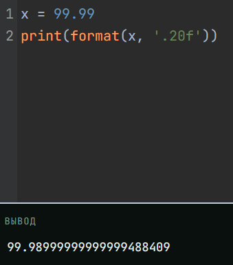
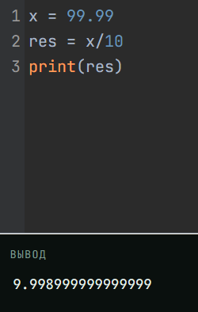
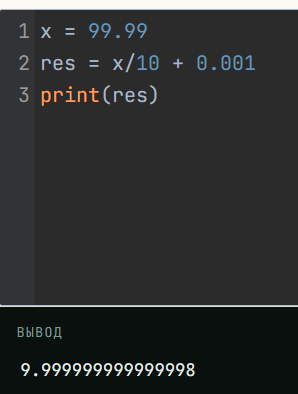
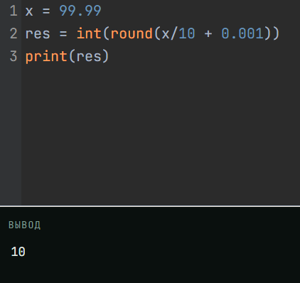

# Языки программирования
## Лабораторная работа 5

### Задание 1 **(2)**
*Переведите в двоичную запись два произвольных рациональных числа (числа вида* $\frac{p}{q}$).
*У одного из чисел знаменатель должен быть степенью двойки (32), а у другого --- некоторым числом
от 9 до 12.*

1. 5/32
* 5/32 < 1
  
    0.0
* 10/32 < 1

     0.00
* 20/32 < 1

     0.000
* 40/32 > 1
  
  40-32=8
  
  8/32 < 1
  
  0.0001
* 16/32 < 1

   0.00010
* 32/32 = 1

  **0.000101**

2. 30/11
* 30/11 = 2 + 8/11

${2=(10)_2}$

  10.

* 16/11 > 1

16/11 = 1 + 5/11

  10.1
    
* 10/11 < 1

  10.10

* 20/11 > 1

20/11 = 1 + 9/11

  10.101

* 18/11 > 1

18/11 = 1 + 7/11

  10.1011

* 14/11 > 1

14/11 = 1 + 3/11

  10.10111

* 6/11 < 1

  10.101110

* 12/11 > 1

12/11 = 1 + 1/11

  10.1011101

* 2/11 < 0

  10.10111010

* 4/11 < 0

  10.101110100

* 8/11 < 1

  10.1011101000

Итог: **10.1011101000...**

Идёт повтор. Период: **1011101000**

*Запись второго числа будет содержать период. Его надо найти. При решении задачи нельзя 
использовать вычислительную технику. Процесс решения должен быть представлен в отчете.*

### Задание 2 **(3)**
*Переведите в двоичную запись и найдите машинное представление в типе* **double**
*для произвольного вещественного числа большего, чем 100 с одним знаком после точки, например
для* $113.7$. *Цифра после точки не должна быть нулем или пятеркой.*

*При решении задачи нельзя 
использовать вычислительную технику. Процесс решения должен быть представлен в отчете.*

**101.1**

* 101/2=50 - 1
* 50/2=25 - 0
* 25/2=12 - 1
* 12/2=6 - 0
* 6/2=3 - 0
* 3/2=1 - 1
* 1/2=0 - 1

 ${101=1100101_2}$

* 0.1*2=0.2 - 0
* 0.2*2=0.4 - 0
* 0.4*2=0.8 - 0
* 0.8*2=1.6 - 1

  1.6-1=0.6
* 0.6*2=1.2 - 1

  1.2-1=0.2

остаток снова 0.2

Ответ: ${1100101.0(0011)_2}$

### Задание 3 **(3)**
*Найдите сумму и произведение для записанных далее пар чисел. Числа заданы в двоичной записи 
в экспоненциальном виде. Ответ необходимо записать в нормализированной экспоненциальном виде.*

* 1.0011e18 и $1.1001e21;
* 1.1011e-25 и, $1.1101e-23;
* 1.1011e-3 и $1.1011e1.
  
*При решении задачи нельзя 
использовать вычислительную технику. Процесс решения должен быть представлен в отчете.*

1. 1.0011*2^18 + 1.1001*2^21

* Приводим к одинаковому порядку, от меньшего к большему

0.0010011*2^21 и 1.1001*2^21

* складываем, но пер этим разряды должны быть одинаковы, поэтому заряды у первого числа теряются

0.0010*2^21 + 1.1001*2^21 = **1.1011*2^21**

2. 1.1011*2^(-25) + 1.1101*2^(-23)
* 0.011011*2^(-23) и 1.1101*2^(-23)
* 0.0110*2^(-23) + 1.1101*2^(-23) = **10.0011*2^(-23)**

```
0+1=1 - младший разряд
1+0=1
1+1=10_2  пишем 0 и переносим 1
0+1+1=0 и перенос единицы
0+1+1=10_2
```
3. 1.1011*2^(-3) и 1.1011*2^1.
* 0.00011011*2^1 и 1.1011*2^1.
* 0.0001*2^1 + 1.1011*2^1 = **1.1100*2^1**

4. 1,0011×2^18 * 1,1001×2^21
* Порядки складываются - 2^39
* Перемножаем мантиссы. Умножим 1.0011 на каждый бит 1.1001:

* 1.0011*1=1.0011
* 1.0011*0.1=0.10011
* 1.0011*0.01=0.010011
* 1.0011*0.001=0.0010011

* суммируем результаты:

* 1.0011 + 0.10011 = 1.11001
* 1.11001 + 0.010011 = 10.000011
* 10.000011 + 0.00010011 = 10.00011111

* нормализуем

* 1.000011111*2^1

Ответ: 1.000011111 * 2^1 * 2^39 = **1.000011111 * 2^40**

5. 1.1011e-25 * 1.1101e-23
* Порядки складываются - 2^(-48)
* Перемножаем мантиссы

* 1.1011 * 1 = 1.1011
* 1.1011 * 0.1 = 0.11011
* 1.1011 * 0.01 = 0.011011
* 1.1011 * 0.001 = 0.0011011

* суммируем результаты:

* 1.1011 + 0.11011 = 10.10001
* 10.10001 + 0.011011 = 10.111101
* 10.111101 + 0.00011011 = 11.00001111

* нормализуем:

* 1.100001111 * 2^1

Ответ: 1.100001111 * 2^1 * 2^(-48) = **1.100001111 * 2^(-47)**

6. 1.1011e-3 * 1.1011e1.
* Порядки складываются - 2^(-2)
* Перемножаем мантиссы

* 1.1011 * 1 = 1.1011
* 1.1011 * 0.1 = 0.11011
* 1.1011 * 0.001 = 0.0011011
* 1.1011 * 0.0001 = 0.00011011

* суммируем результаты:

* 1.1011 + 0.11011 = 10.10001
* 10.10001 + 0.0011011 = 10.1011111
* 10.1011111 + 0.00011011 = 10.11011001

* нормализуем:

* 1.011011001 * 2^1

Ответ: 1.011011001 * 2^1 * 2^(-2) = **1.011011001 * 2^(-1)**

### Задание 4 **(2)**

*Рассмотрим следующий пример в IDLE Python*
```
>>> x = 99.99
>>> int(x/10+0.001)
9
```
*Результат должен был быть равен 10, однако оказался другим. Почему так произошло?*

Python хранит вещественные числа в формате double. Это значит, что 99.99 хранится как ближайшее представимое число.


при делении на 10 значение x примерно = 9.998999999999999


прибавляем 0.001


Также в Python функция int() отбрасывает дробную часть, а не округляет
*Как исправить программу, чтобы она корректно переводила вещественные числа в целые?*
можно добавить функцию round()


### Задание 5. **(2)**

*Рассмотрите следующую программу. Объясните результаты ее работы. В частности,
как величина* $y$ *повлияла на ответ?*
```
x = 1/3
y = 1
for i in range(20):
    print((x+y)-y)
    y*=10
```
*В отчете требуется привести вычисления для оценки погрешности.*


### Задание 6 **(2)**

*Для какого минимального значения* $n$ *программа на С++ выведет* **inf**? *Объясните
ответ.* *Что произойдет, если тип* **double** *заменить на* **long double**?
```
int n=...;
double s = pow(2, n);
std::cout << std::fixed << s << std::endl;
```

### Задание 7 **(2)**

*Допишите что-либо вместо многоточия программе на С++, чтобы программа при запуске выдавала ответ* **yes**.
```
double s = ...;
if (s != s)
  std::cout << "yes";
```

### Задание 8 **(2)**

*Какое минимальное натуральное число при преобразовании в тип* **double** *записывается с погрешностью? Объясните
ответ. Почему следующее за ним число уже выводится без погрешности?*

Наименьшее натуральное число, которое требует 54 бита для точной записи, — это: $2^{53}$+1
Проверим: $2^{53}$ = 9 007 199 254 740 992 — точно представляется (это степень двойки).

 $2^{53}$+1 в двоичном виде: единица, 52 нуля, затем ещё одна единица.
Это 54 значащих бита (первая и последняя единицы, между ними нули).

Мантисса double может хранить только 53 значащих бита. Поэтому $2^{53}$+1 округляется.
По правилам IEEE 754 округление идёт к ближайшему чётному.

Ближайшее чётное — $2^{53}$ (у него последний бит мантиссы 0).
Значит, $2^{53}$+1 превращается в $2^{53}$, то есть с погрешностью 1.

Ответ: минимальное натуральное число — $2^{53}$+1 = 9 007 199 254 740 993.


Следующее число — $2^{53}$+2

В двоичном виде: единица, 52 нуля, затем единица и ноль — то есть последний бит равен 0.
Это значит, что число можно представить как: $2^{53}$+2=2*($2^{52}$+1)
Мантисса: $2^{52}$+1 — это 53 значащих бита (первая единица, 51 ноль, последняя единица).
Умножение на $2^{1}$ просто увеличивает экспоненту, не меняя мантиссу.
Значит, $2^{53}$+2 точно укладывается в 53 бита мантиссы и записывается без погрешности.


###  Задание 9 **(2)**
*Напишите программу для решения следующей задачи.*

*Даны четыре рациональных числа. (Рациональное число - это число вида*
$\frac{p}{q}$, *где* $p$ *и* $q$ - *целые числа.) Напишите программу, которая сравнит сумму
двух первых чисел с суммой двух последних чисел. Программа должна выводить* $1$, $0$ *или* $-1$
*в зависимости от результатов сравнения. Решение можно проверить в проверяющей системе*
[http://olymp3.isu.ru/cgi-bin/new-client?contest_id=102](http://olymp3.isu.ru/cgi-bin/new-client?contest_id=102), *задача 03*.
```
t = int(input())
res = []

i = 0
while i < t:
    p1, q1, p2, q2, p3, q3, p4, q4 = map(int, input().split())

    A = p1 * q2 + p2 * q1
    B = q1 * q2
    C = p3 * q4 + p4 * q3
    D = q3 * q4

    left = A * D
    right = C * B

    if left > right:
        res.append("1")
    elif left < right:
        res.append("-1")
    else:
        res.append("0")

    i += 1

print(" ".join(res))
```
