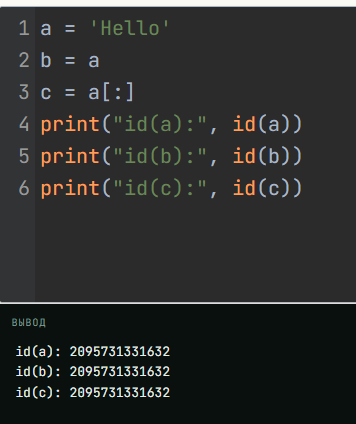

# Языки программирования
## Лабораторная работа 6

### Задание 1 **(3)**
*Рассмотрим следующую программу на С++.*
```
#include <iostream>
#include <cmath>
int main() {
   double x = 0;
   const auto Pi = std::acos(0) * 2;
   std::cout << Pi << std::endl;
   return 0;
}
```
*Проверьте четыре способа объявления* **Pi**.
* ```const auto Pi = acos(0) * 2;```
* ```constexpr auto Pi = std::acos(0) * 2;```
* ```const auto Pi = acos(x) * 2;```
* ```constexpr auto Pi = std::acos(x) * 2;```

*Что можно сказать об этих вариантах? Проверьте, в каких вариантах объявляется константа этапа трасляции.*

*Тексты программ разместите в папке с номером задания*


### Задание 2 **(2)**
*Проверьте работу следующей программы на С++*
```
#include <iostream>
int main() {
   {
      int x, y;
      std::cin >> x >> y;
      std::cout << x+y << std::endl;
   }
   {
      double x, y;
      std::cin >> x >> y;
      std::cout << x+y << std::endl;
   }
   return 0;
}
```
*Нужны ли в этой программе вложенные фигурные скобки? Дайте подробный ответ с объяснением причин.*

фигурные скобки нужны, потому что переменные объявленные внутри фигкрных скобок, существуют только до закрывающей скобки этого блока. Посде они уничтожаются. а если убрать скобки то все четфре переменные будут в одной области видимости и компилятор выдаст ошибку. 

### Задание 3 **(2)**
*Проверьте работу следующего фрагмента программы на С++.*
```
int s = 0;
for (int i = 0; i < 4; i++) {
   for (int i = 0; i < 3; i++) {
      s += i;
   } 
   s += i; 
}
std::cout << s;
```
*В результате каких вычислений был получен ответ? Дайте подробный ответ.*

переменные **i** во внешнем и во внутреннем цикле это две разные переменные. После того как внутреннмий цикл заканчивается переменная **i** уничтожается и **s += i** использует внешнюю переменную **i**

* Внутренний цикл выполняется 3 раза для каждого значения внешней i.

* Внутренняя **i** принимает значения 0, 1, 2, и **s** увеличивается на 0 + 1 + 2 = 3 за каждую итерацию внешнего цикла (их 4). Итого 4 * 3 = 12.

* После внутреннего цикла s += i выполняется для внешней переменной. Внешняя i принимает значения 0, 1, 2, 3. Сумма этих значений равна 0 + 1 + 2 + 3 = 6.

* **s = 12 + 6 = 18**

### Задание 4 **(2)**

*Проверьте работу следующего фрагмента программы на* **Python**.
```
s = 0
for i in range(4):
   for i in range(3):
      s += i
   s += i
print(s)
```
*В результате каких вычислений был получен ответ? Дайте подробный ответ.*

цикл **for** не создаёт область видимости поэтому оба переменные **i** это одна и та же переменная. После завершения внутреннего цикла **i** сохраняет последнее присвоенное значение и прибавляет к **s**.

* Внутренний цикл за одну итерацию внешнего цикла добавляет 0 + 1 + 2 = 3.

* Всего итераций внешнего цикла четыре: 4 * 3 = 12.

* После каждого внутреннего цикла последнее значение переменной **i**=2 и это повторяется 4 раза: 4 × 2 = 8.

**12 + 8 = 20**


*На основе этих примеров поясните различия между* **С++** и **Python** *при работе с переменными*.

В C++ переменные имеют область видимости с помощью фигурных скобок. Объявление переменной во внутреннем блоке создаёт новую сущность, скрывающую внешнюю. 

В Python области видимости не создаются циклами или блоками. Поэтому переменные **i** это одна и та же переменная.


### Задание 5 **(2)**

*Напишите свой пример программы на* **С++**, *создающий и использующий пространства имен. Программа
должна содержать не менее двух пространств имен.*

```
#include <iostream>

namespace ploshad {
    const double PI = 3.14159;
    double circle(int radius) {
        return PI * radius * radius;
    }
}

namespace privetstvie {
    void hello(const std::string& name) {
        std::cout << "Привет, " << name << "!" << std::endl;
    }
}

int main() {
    std::cout <<  ploshad::circle(2) << std::endl; privetstvie::hello("мама");
    return 0;
}
```

### Задание 6 **(2)**

*Рассмотрим следующий фрагмент программы. Эта программа 1000000 раз обменивает значения двух длинных 
строк с использованием третьей строки. Проверьте, насколько быстро она работает.*

```
std::string a(100000, 'a');
std::string b(100000, 'b');
for (int i=0;i<1000000;i++) {
   std::string c(a);
   a = b;
   b = c;
}
std::cout << a[0] << b[0];
```
*Попробуйте использовать для обмена значений строк функцию* **swap**. 
*Проверьте, изменилось ли время работы. В чем ошибка исходной программы?
Исправьте исходную программу, чтобы ускорить ее работу. Изменения не должны 
затрагивать общий вид программы (присваивания, использование временной переменной).*


### Задание 7 **(2)**

*Рассмотрим программу на языке* **Python**.
```
a = 'Hello world'
print(a, id(a))
b = a
print(b, id(b))
a += ' and goodbye'
print(a, id(a))
print(b, id(b))
```
*Объясните ее работу. В какой момент создавались строки? 
Что означает значение, возвращенное функцией* **id**?

### Задание 8 **(2)**

*Пусть* **a** - *строковая переменная в программе на* **Python**.
*Есть ли разница между работой присваивания*
```b = a```
и
```b = a[:]```
*Напишите программу для демонстрации различий.*

```
a = 'Hello'
b = a
c = a[:]
print("id(a):", id(a))
print("id(b):", id(b))
print("id(c):", id(c))

```
* 
* 

###  Задание 9 **(3)**
*Напишите программу на языке* **Python**, *которая создаст 2600 переменных с именами
от* **a0** *до* **a99**, *от* **b0** *до* **b99** *и так далее, от* **z0** *до* **z99**. 
*Присвойте всем переменным различные значения от 1 до 2600.*
